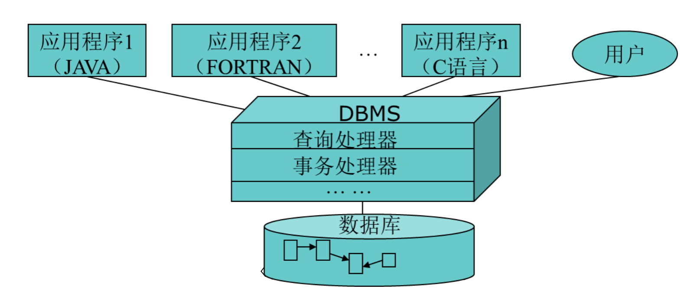
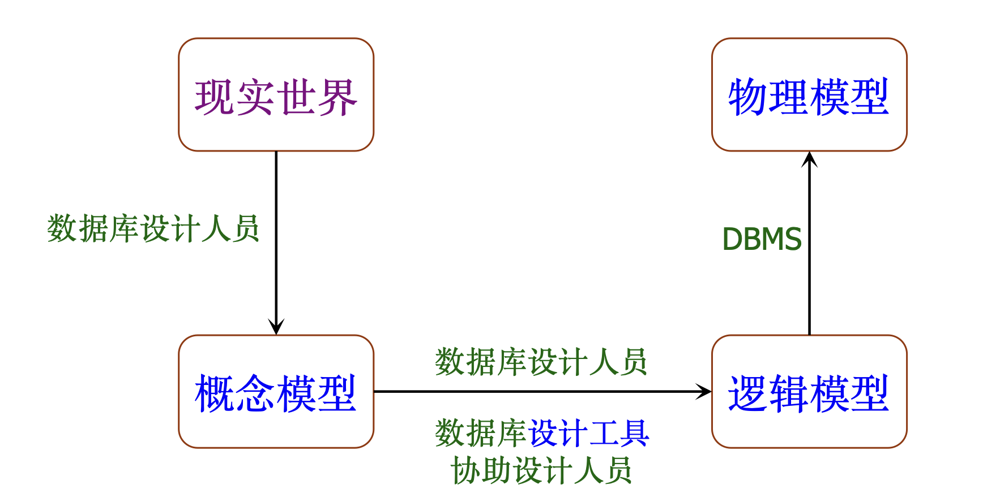
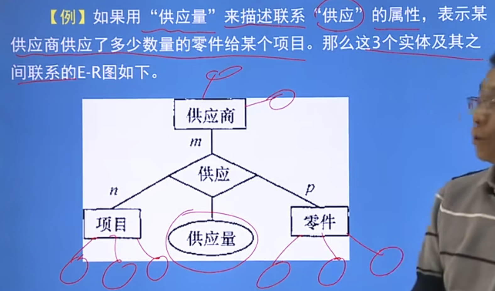
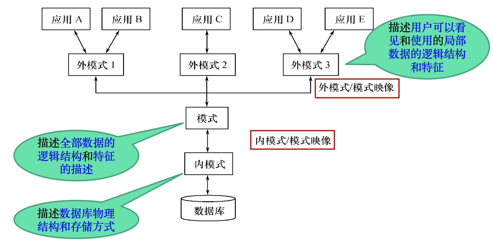

# Introduction

## 数据库系统 (Database System)

数据 (Data)：数据是数据库中存储的基本对象。

> 数据可以是文字、图像、视频、语音等等。

数据库 (Database)：数据库是长期存储在计算机内、有组织的、可共享的大量数据的集合。

> 数据库的特点：长期存储、有组织、可共享。

数据库管理系统 (Database Management System)：用于管理数据库的系统。

> - 数据库管理系统提供数据定义语言 (Data Definition Language)，用户可以通过它对数据库中的数据对象进行定义。
> - 数据库管理系统提供数据操作语言 (Data manipulation Language)，实现对数据库的插入、删除等等操作。

数据库系统 (Database System)：数据库系统由数据库、数据库管理系统及其开发工具、应用系统、数据库管理员构成。

数据库系统的特点：

- **数据冗余小，易于扩充**：不同程序可以复用同一套数据
- **数据独立性高**：数据不依赖于程序而存在，让数据和程序彼此独立
- 面向全组织的复杂数据结构：从整体从发来考虑数据结构，不但要描述数据本身，而且要描述数据之间的联系
- 统一的数据管理、控制功能：允许多个用户或多个应用程序同时访问数据库中的相同数据

> 数据的独立性包括**物理数据独立性**和**逻辑数据独立性**。

## 数据模型 (Data Model)

数据模型：人们对于现实世界的数据特征的抽象，就是现实世界的模拟。

> 数据模型是数据库系统的核心和基础。

数据模型的要求；

- 对于现实世界的模拟
- 便于人类理解
- 便于在计算机上实现

有两种类型的数据模型：

- 概念模型
- 逻辑模型和物理模型

### 数据模型的组成要素

数据模型有以下组成要素：

- 数据结构：数据库的**组成对象**及其之间的联系，所描述的对象类型的集合，是对系统静态特性的描述
- 数据操作：对数据库中各种对象（型）和实例（值）允许执行的操作的集合，是对系统动态特性的描述
- 完整性约束：对数据库中的数据规定一些必须遵守的规则，保证数据符合实际业务要求，避免出现错误或不合理的数据

### 概念模型、逻辑模型和物理模型

概念模型：按**用户的观点**对数据和信息建模，主要用于数据库设计。

逻辑模型：按**计算机系统的观点**对数据建模，主要用于DBMS的实现。

物理模型：**数据最底层的抽象**，面向计算机系统。

> 逻辑模型具体有层次模型、网状模型、**关系模型**、面向对象模型、对象-关系模型。

### E-R模型和关系模型

#### E-R模型

概念模型是现实世界到信息世界的中间层次，常用E-R模型（实体-关系模型）表示。

E-R模型中的概念：

- 实体：客观存在并相互区别的事物。
- 属性：实体由若干属性进行刻画。
- 码：唯一标识实体的属性集，注意**可以不唯一**。
- 域：属性的取值范围。
- 实体型：具有相同属性的实体的类型。
- 实体集：同一个实体型的不同实体构成的集合。
- 联系：**不同实体集**之间的联系。

> [!NOTE]
>
> - 码不一定是单个属性，也可以是多个属性构成的集合组成。
> - 实体型相当于类，实体相当于这个类的实例，实体集相当于多个实体组成的集合。
> - 联系有1:1，1:n，m:n这几种联系。

画E-R图中，不同的形状有以下的含义：

- 矩形：代表实体型
- 菱形：代表**相同或不同实体型**之间的联系
- 椭圆形：代表**实体型或者联系**的属性
- 连线：连接实体型、属性和联系

#### 关系模型

层次模型、网状模型、关系模型是常用的逻辑数据模型，其中关系模型是最常用最重要的。

关系模型的概念有：

- 关系：不可再拆分的二维表
- 元组：表中的每一行表示一个元组，表示一条信息
- 属性：表中的一列表示一个属性，每一列有唯一的名字
- 码：表中的**属性组**，**能够唯一确定一个元组**
- 域：属性的取值范围
- 分量：元组中的一个属性
- 关系模式（型）：对关系的描述，比如 `学生（学号，姓名，年龄，性别，系，年级）`

> [!NOTE]
>
> E-R模型中的联系和关系模型的关系不是同一个概念：
>
> - **E-R 模型中的联系**描述的是实体之间在现实世界中的关联
> - **关系模型中的关系**可以理解为一张逻辑上的二维表
>
> E-R模型中的实体就对应关系模型中的一个元组，**实体集/联系**对应关系模型中的关系。
>
> **关系模型中实体与实体之间的联系都用关系来表示**。

## 数据库系统结构

### 三级模式结构

模式 (Schema)：对数据库结构的定义。

实例 (Instance)：数据库在某一时刻实际存放的数据。

> 用学生表来理解，
>
> 1. 定义关系模型中一张表为 `学生 (学号，姓名，专业）` ，则这个就是模式
>
> 2. 某一时刻有 `(001， XIAOLI， CS)` 数据，则这个就是实例

三级模式结构包含：

- 三层模式：外模式 (External Schema)，模式 (Schema)，内模式 (Internal Schema)
- 二层映象：外模式/模式映象，模式/内模式映象

> 外模式也称为用户模式，模式也称为逻辑模式，内模式也称为存储模式。

> [!NOTE]
>
> **一个数据库只有一个内模式，一个模式，可以有多个外模式**。
>
> **一个应用程序只能有一个外模式**。

数据库的三级模式和二级映象设计有以下优点：

- 保证了数据与程序之间的独立性，使得数据的定义和描述可以从应用程序中分离出去
- 保证了数据库外模式的稳定性，从而从底层保证了应用程序的稳定性 

