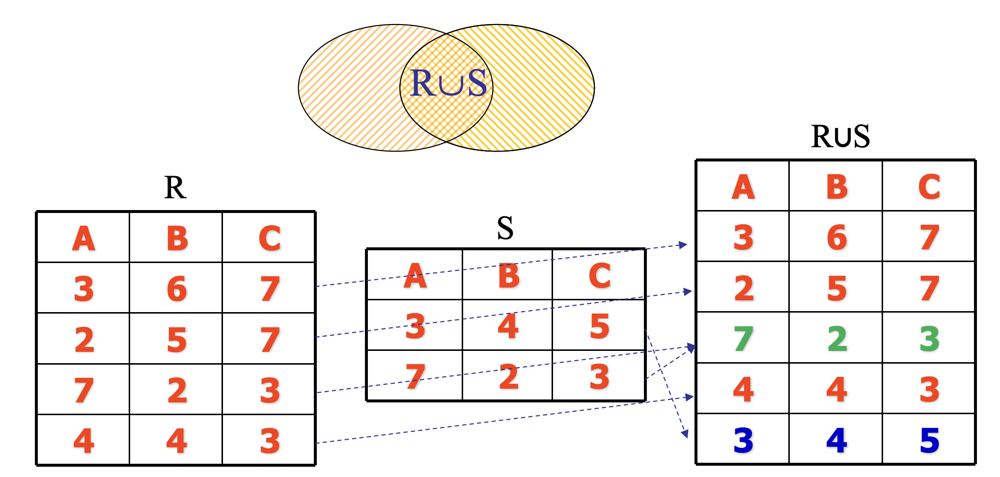
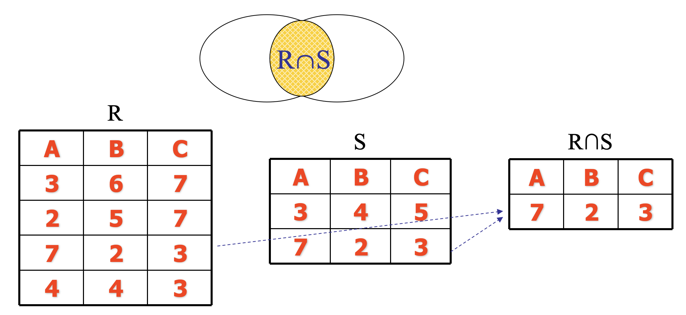
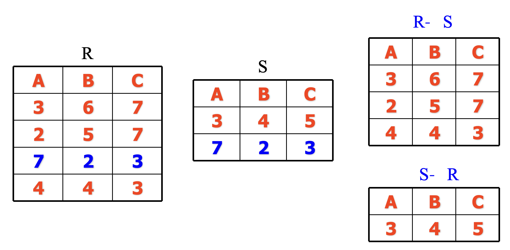
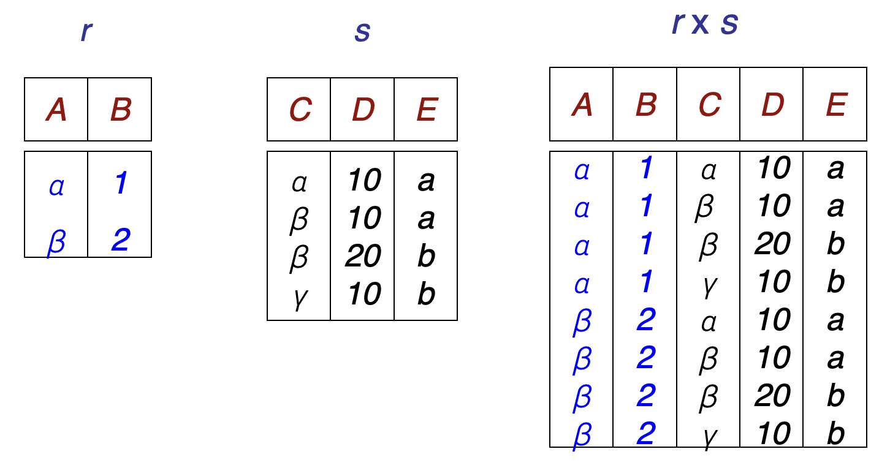
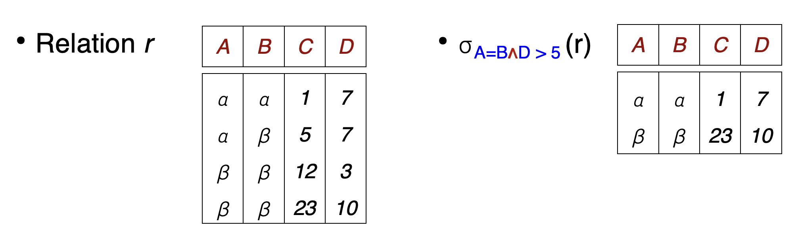
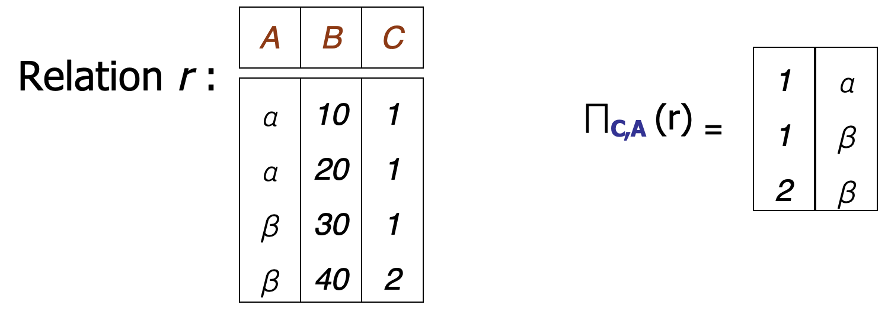
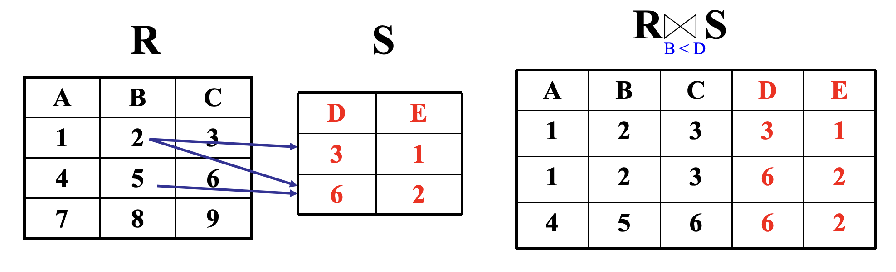
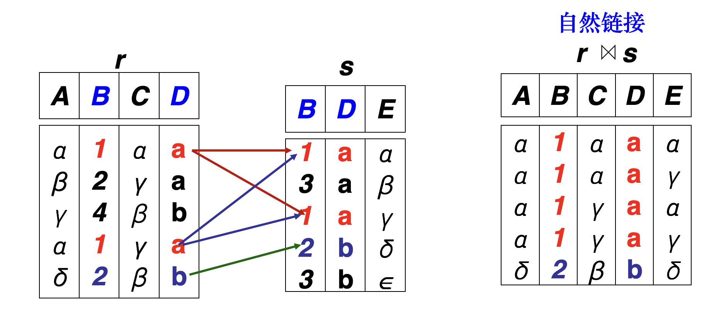
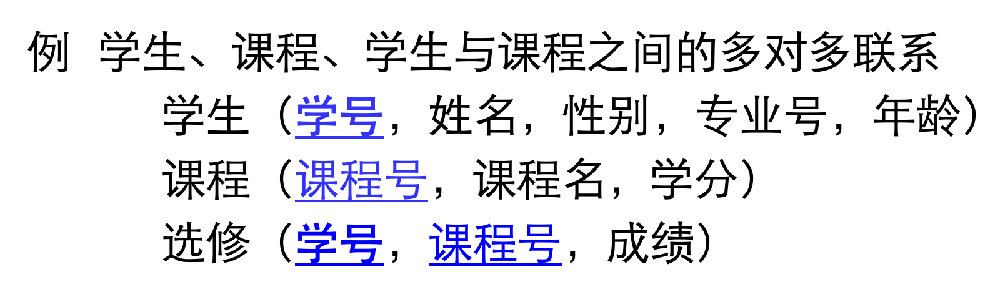

# 关系数据库

## 关系数据结构

### 关系

**在关系数据库中，数据结构是一张二维表，用关系指代表**。

**每张表都有唯一的名称，关系是元组的集合**。

关系有三种基本类型：

- 基本关系：实际存在的表，是实际存储数据的逻辑表示。
- 查询关系：从一个/多个基本关系中查询的结果对应的表。
- 视图关系：由基本表或其他视图表导出的表，不对应实际存储的数据。

#### 形式化定义

域：具有相同数据类型的**值**的集合。

笛卡尔积：给定一组域D1, D2, …, Dn, 这些域中可以有相同的域。D1, D2, …, Dn的笛卡儿积为：D1×D2×…×Dn＝{(d1,d2,…,dn)| di∈Di, i=1, 2, …, n}，其中每一个元素(d1,d2,…,dn)称为一个n元组。元素中的每个值di称为一个分量。

基数：若$D_i (i=1, 2, …, n)$为有限集，其基数为$|Di|$，则D1×D2×… ×Dn的基数为：|D1|×|D2|×...×|Dn|。

目 (度)；D1×D2×… ×Dn的任意子集叫做在域D1, D2, …, Dn上的关系，n是关系的**目**或度。

> [!NOTE]
>
> 集合论中笛卡儿积不满足交换率，即笛卡儿积的元组有序，$D_1 \times D_2 \neq D_2 \times D_1$ 。

#### 基本关系的性质

基本关系有如下性质：

- 列是同质的，不同列可出自同一个域
- 每一列为一个属性，不同属性 (列) 给不同属性名
- 列的顺序可任意交换，行的顺序可任意交换
- 任意两个元组不能完全相同 (任意两个元组的候选码不能相同)
- 每一分量是不可分的数据项（原子的）

#### 码

超码：能唯一标识一行的属性或属性组合，可以包含多余属性。

候选码：没有多余属性的超码，去掉其中任何一个属性，就不能再唯一标识一行。

主码：从候选码中选定的**一个或多个属性**作为主要标识。

> 有关系 `学生（学号，身份证号，姓名，专业）`：
>
> - 超码可以是 `(学号，姓名)`，`身份证号`...
> - 候选码是 `学号`，`身份证号`
> - 主码可以是 `学号` 或者 `身份证号`

全码：关系模式的所有属性组构成此关系模式的唯一候选码。

> 有这样一种关系 `选课 (学号，课程号)`，只有两个属性都确定了才能锁定唯一记录，所以 `(学号，课程号)` 就是全码。

外码：是一个关系中的属性或属性组合，它引用另一个关系中的候选码，用来表示和约束两个关系之间的联系。

> 有两种关系：
>
> 1. `专业 (专业号，专业名称)`
> 2. `学生 (学号，姓名，专业)`
>
> 其中专业号是专业关系中的候选码，在学生关系中就是外码。

### 关系模型

关系模式：关系模式是对关系的描述，包含以下内容，

- 属性构成 `F`

- 属性来自的域 `D`

- 属性与域之间的映象关系 `Dom`

- 属性间的数据依赖关系集合 `F`
- 元组语义以及完整性约束条件

关系模式通常表示为 `R(U, D, Dom, F)`，也可以简化为 `R(A1, A2, ..., An)`。

### 关系数据库

关系数据库：在给定应用领域中，用于描述所有实体和实体间联系的**关系的集合**构成一个关系数据库。

同样地关系数据库也有型和值的区别：

- 型：关系数据库模式，是对关系数据库的描述
- 值：一般就称为关系数据库 (实例)

## 关系操作

关系数据库的操作主要有两类：

- **查询操作：并，差，交，笛卡尔积，选择，投影，连接，除**
- **更新操作：插入，删除，修改**

关系操作的特点是**集合操作方式**：操作对象和结果都是关系

关系数据语言有以下分类：

- 关系代数语言 (代数方式)：ISBL
- 关系演算语言 (逻辑方式)：ALPHA, QUEL, QBE
- 具有关系代数和关系演算双重特点的语言：SQL

### 关系代数

关系代数是一种抽象的查询语言，通过对关系的运算来表达查询。

关系代数的**运算对象是关系**，运算结果亦为**关系**。

关系代数用到的运算主要包括：

- **传统的集合运算：并，交，差，笛卡尔积**
- **专门的关系运算：选择，投影，连接，除**

#### 并

要求：两个关系的目相同并且相同位置属性的域相同。

操作：$R \cup S = \{t | t \in R \or t \in S\}$，两个关系去掉重复的元组和在一起。

#### 交

要求：两个关系的目相同并且相同位置属性的域相同。

操作：$R \cap S = \{t|t \in R \and t \in S\}$​，两个关系中都存在的元组。

#### 差

要求：两个关系的目相同并且相同位置属性的域相同。

操作：$R - S = \{t|t \in R \and t \notin S\}$，在R中但是不在S中的元组。

#### 笛卡尔积

要求：两个分别为n目和m目的关系R和S的广义笛卡尔积是一个(n+m)列的元组的集合。

操作：$R \times S = \{\widehat{t_Rt_S}|t_R \in R \and t_S \in S\}$​，元组的前n列是关系R的一个元组，后m列是关系S的一个元组。

> R：目为n，基数为x
>
> S：目为m，基数为y
>
> 则$R \times S$的目为n+m，基数为xy

#### 选择

关系 $R(A_1, A_2, ..., A_n)$ 有以下记号：

1. $t \in R$ 表示是关系R中的元组
2. $t[A_i]$ 表示是元组中属性 $A_i$ 的分量

操作：$\sigma_{F}{R}=\{t|t \in R \and F(t)=True\}$​，在关系R中选择满足给定条件的元组。

> F表示选择条件，它是一个逻辑表达式，取逻辑值‘真’或‘假’。

#### 投影

操作：从R中选择出若干**属性列**组成**新的关系**，记作： $\Pi_{A}(R) = \{ t[A] | t \in R \}$。

> 其中A是新关系的属性。

#### 连接

操作：$R \bowtie_{A \theta B} S
= \left\{
\widehat{t_r t_s}
\mid
t_r \in R \land t_s \in S
\land t_r[A] \mathrel{\theta} t_s[B]
\right\}$，从两个关系的**笛卡尔积**中选取属性间满足一定条件的元组。

##### 等值连接

操作：θ为=的连接运算称为等值连接（equijoin），它是从关系R与S的笛卡尔积中选取A、B属性值相等的那些元组。

##### 自然连接

一种特殊的等值连接，它要求两个关系中进行比较的分量必须是**相同的属性组**，并且要在结果中把**重复的属性去掉**。

## 关系的完整性要求

关系模型的完整性要求是对关系的某种约束条件，主要有三类完整性要求：

- 实体完整性：**关系必有主码，构成主码的各属性值均不能取空值**。
- 参照完整性：一个关系的外码引用另一个关系的码时，**外码的值必须有对应的记录，或者在允许的情况下为空**。
- 用户定义的完整性：针对某一具体关系数据库的约束条件，它反映某一具体应用**所涉及的数据**必须满足的语义要求。

> 实体完整性和参照完整性是关系模型必须满足的完整性约束，由关系系统自动支持。
>
>  用户定义的完整性是由用户自己设定的。

