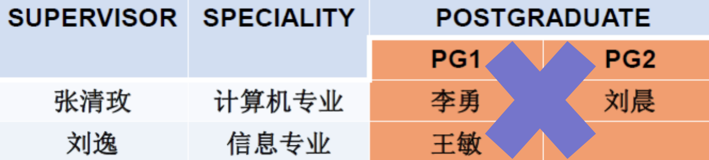
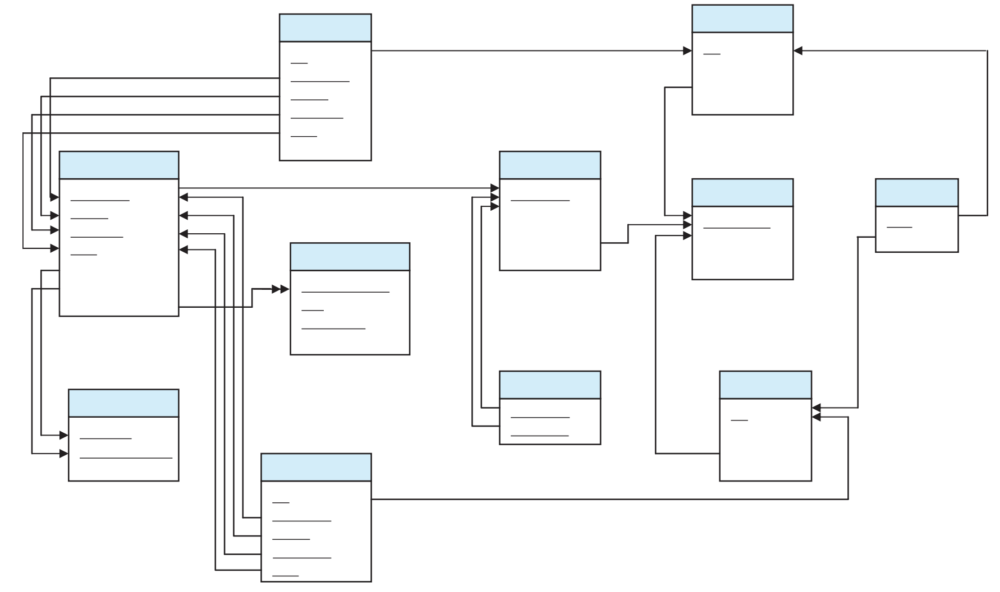

# 关系数据库

## 关系数据结构

### 关系

**在关系数据库中，数据结构是一张二维表，用关系指代表**。

**每张表都有唯一的名称，关系是元组的集合**。

关系有三种基本类型：

- 基本关系：实际存在的表，是实际存储数据的逻辑表示。
- 查询关系：从一个/多个基本关系中查询的结果对应的表。
- 视图关系：由基本表或其他视图表导出的表，不对应实际存储的数据。

#### 形式化定义

域：具有相同数据类型的**值**的集合。

笛卡尔积：给定一组域D1, D2, …, Dn, 这些域中可以有相同的域。D1, D2, …, Dn的笛卡儿积为：D1×D2×…×Dn＝{(d1,d2,…,dn)| di∈Di, i=1, 2, …, n}，其中每一个元素(d1,d2,…,dn)称为一个n元组。元素中的每个值di称为一个分量。

基数：若$D_i (i=1, 2, …, n)$为有限集，其基数为$|Di|$，则D1×D2×… ×Dn的基数为：|D1|×|D2|×...×|Dn|。

目 (度)；D1×D2×… ×Dn的任意子集叫做在域D1, D2, …, Dn上的关系，n是关系的**目**或度。

> [!NOTE]
>
> 集合论中笛卡儿积不满足交换率，即笛卡儿积的元组有序，$D_1 \times D_2 \neq D_2 \times D_1$ 。

#### 基本关系的性质

基本关系有如下性质：

- 列是同质的，不同列可出自同一个域
- 每一列为一个属性，不同属性 (列) 给不同属性名
- 列的顺序可任意交换，行的顺序可任意交换
- 任意两个元组不能完全相同 (任意两个元组的候选码不能相同)
- 每一分量是不可分的数据项（原子的）

#### 码

超码：能唯一标识一行的属性或属性组合，可以包含多余属性。

候选码：没有多余属性的超码，去掉其中任何一个属性，就不能再唯一标识一行。

主码：从候选码中选定的一个，作为主要标识。

> 有关系 `学生（学号，身份证号，姓名，专业）`：
>
> - 超码可以是 `(学号，姓名)`，`身份证号`...
> - 候选码是 `学号`，`身份证号`
> - 主码可以是 `学号` 或者 `身份证号`

全码：关系模式的所有属性组构成此关系模式的唯一候选码。

> 有这样一种关系 `选课 (学号，课程号)`，只有两个属性都确定了才能锁定唯一记录，所以 `(学号，课程号)` 就是全码。

外码：是一个关系中的属性或属性组合，它引用另一个关系中的候选码，用来表示和约束两个关系之间的联系。

> 有两种关系：
>
> 1. `专业 (专业号，专业名称)`
> 2. `学生 (学号，姓名，专业)`
>
> 其中专业号是专业关系中的候选码，在学生关系中就是外码。

### 关系模型

关系模式：关系模式是对关系的描述，包含以下内容，

- 属性构成 `F`

- 属性来自的域 `D`

- 属性与域之间的映象关系 `Dom`

- 属性间的数据依赖关系集合 `F`
- 元组语义以及完整性约束条件

关系模式通常表示为 `R(U, D, Dom, F)`，也可以简化为 `R(A1, A2, ..., An)`。

### 关系数据库

关系数据库：在给定应用领域中，用于描述所有实体和实体间联系的**关系的集合**构成一个关系数据库。

同样地关系数据库也有型和值的区别：

- 型：关系数据库模式，是对关系数据库的描述
- 值：一般就称为关系数据库 (实例)

## 关系操作

