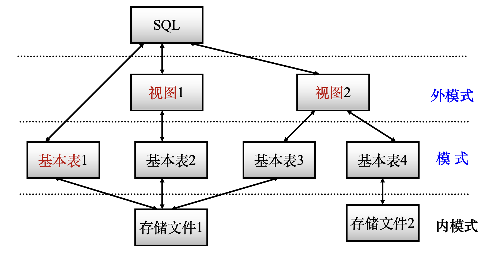
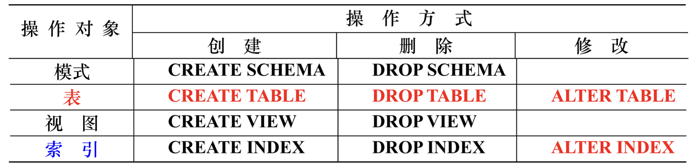
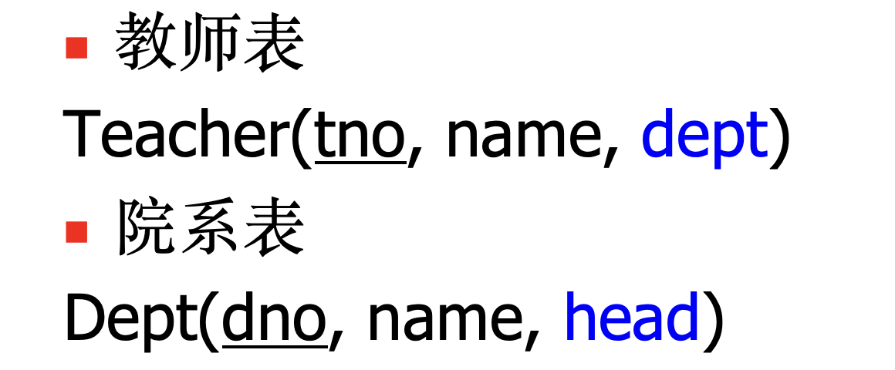

# SQL

## SQL概述

### SQL的基本概念

基本表：本身独立存在的表，在SQL中一个关系就对应一个表。

视图：从基本表或者其他视图中导出的表。

索引：帮助数据库更快找到数据的结构。

存储文件：一个或多个基本表对应一个存储文件。

> [!NOTE]
>
> - 用户可以用SQL对**基本表和视图**进行查询，在用户眼中**视图和基本表都是关系**
> - **视图是一个虚表**，数据库中只存放**视图的定义**而不存放视图对应的数据
> - 一个表可以有**多个索引**，**索引也存放在存储文件中**
> - 存储文件组成了关系数据库的内模式，存放在计算机内任意位置

### SQL与三级模式结构的关系

外模式：视图和部分基本表

模式：基本表

内模式：存储文件



### SQL的特点

SQL的特点：

- 综合统一：SQL集数据查询、数据操作、事务控制、授权等等为一体
- 高度非过程化：SQL进行数据操作只需要提出要做什么，而不必声明怎么做
- 面向集合：操作对象是集合，得到的结果也是集合
- 两种使用方式：既是自含式语言可以自己单独编写，又是嵌入式语言可以嵌入到C/C++等
- 使用简洁统一：核心功能只需9个动词 `select`, `create`, `drop`, `alter`, `insert`, `update`, `delete`, `grant`, `revoke`

## SQL操作

### 数据类型

| 变量类型       | 作用                                              |
| -------------- | ------------------------------------------------- |
| `char(n)`      | 长度为n的定长字符串，e.g., `liam`, `kris`         |
| `varchar(n)`   | 最大长度为n的变长字符串，e.g., `liam`, `alice`    |
| `int`          | 长整数，e.g., `12345678`                          |
| `smallint`     | 短整数                                            |
| `numeric(p,d)` | 定点数，长度为p且小数点后位数为d，e.g., `1234.45` |
| `real`         | 浮点数                                            |
| `date`         | 日期，格式为`YYYY-MM-DD`                          |
| `time`         | 时间，格式为`HH:MM:SS`                            |

### 定义

用`create`来定义创建模式、基本表、视图、索引。

模式的定义：

```sql
create schema <schema_name> authorization <username>
/* 如果没有定义模式名，则模式名隐含为用户名 */
create schema authorization <username>

/* e.g. */
CREATE SCHEMA school AUTHORIZATION liam;
```

> [!NOTE]
>
> 定义模式实际上定义了一个数据库的**命名空间**，在这个空间中可以定义该模式包含的数据库对象，例如基本表、视图、索引等。

基本表的定义：

```sql
/* <>是必须填入的内容，[]是选择性填入的内容 */
create table <table_name> (
	<column_name1> <data_type> [column_level_constraint1],
	<column_name2> <data_type> [column_level_constraint2],
	...
	[table_level_constraint1],
  [table_level_constraint2]
);

/* e.g. */
create table student(
	id char(13) primary key,
  name varchar(40) not null,
  gender char(2) not null,
  age int check (120 >= age and age >= 0),
  college_id char(20) references college(id)
);

/* 全部写成表级约束 */
/* not null只能写成列级约束 */
create table student(
	id char(13),
  name varchar(40) not null,
  gender char(2) not null,
  age int,
  college_id char(20),
  
  /* 前面可以加上constraint <constraint_name>来定义约束名 */
  primary key (id),
  foreign key (college_id) references college(id),
  check (120 >= age and age >= 0)
);
```

模式和表的关系：

- 每一个基本表**属于**某一个模式，一个模式包含多个基本表
- 定义基本表所属模式有两种方式，在创建模式语句中同时创建表，或者在表名中明显地给出模式名



### 删除

模式的删除：

```sql
drop schema <schema_name> <cascade/restrict>

/* e.g. */
drop schema school cascade;
```

- `cascade`：删除模式的同时把该模式中所有的数据库对象**全部删除**
- `restrict`：如果该模式中定义了下属的数据库对象，则**拒绝**该删除**语句的**执行

基本表的删除：
````sql
drop table <table_name> <cascade/restrict>

/* e.g. */
drop table student cascade;
````

### 修改

修改已经存在的基本表：

````sql
alter table <table_name>
[add <new_column_name> <data_type> <column_level_constraint>]
[drop <table_level_constraint_name>]
[alter column <column_name> <data_type>]

/* e.g. */
alter table student add enrollment_time date not null;
alter table student drop column gender;
alter table student drop constraint age_check;
alter table student alter column name varchar(10);
alter table student rename column name to chinese_name;
...
````

注意表在定义的时候不能产生循环定义的现象，比如这个例子：



````sql
/* 以下定义方式是错误的，因为产生了循环定义 */
create table Teacher(
	tno char(13) primary key,
  name varchar(100) not null,
  dept char(20) references Dept(dno)
);

create table Dept(
	dno char(20) primary key,
  name varchar(100) not null,
  head char(13) references Teacher(tno)
);

/* ================================ */

/* 这是正确的定义方式 */

create table Teacher(
	tno char(13) primary key,
  name varchar(100) not null,
  dept char(20)
);

create table Dept(
	dno char(20) primary key,
  name varchar(100) not null,
  head char(13)
);

alter table Teacher add constraint dept_constraint foreign key (dept) references Dept(dno);
alter table Dept add constraint head_constraint foreign key (head) references Teacher(tno);
````

### 查询


### 更新

 
