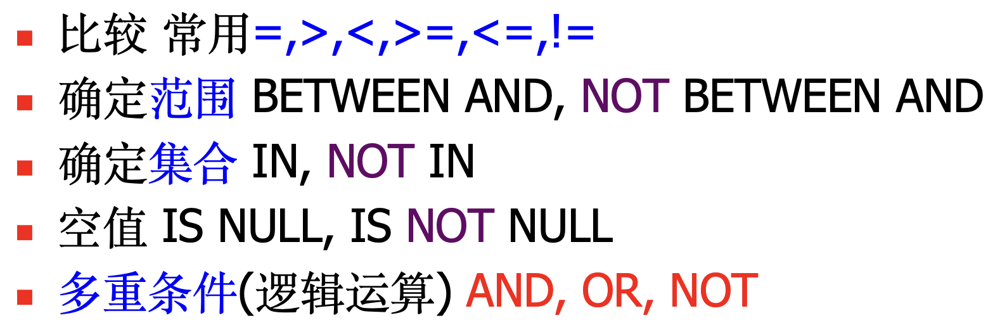

# SQL

## SQL概述

### SQL的基本概念

基本表：本身独立存在的表，在SQL中一个关系就对应一个表。

视图：从基本表或者其他视图中导出的表。

索引：帮助数据库更快找到数据的结构。

存储文件：一个或多个基本表对应一个存储文件。

> [!NOTE]
>
> - 用户可以用SQL对**基本表和视图**进行查询，在用户眼中**视图和基本表都是关系**
> - **视图是一个虚表**，数据库中只存放**视图的定义**而不存放视图对应的数据
> - 一个表可以有**多个索引**，**索引也存放在存储文件中**
> - 存储文件组成了关系数据库的内模式，存放在计算机内任意位置

### SQL与三级模式结构的关系

外模式：视图和部分基本表

模式：基本表

内模式：存储文件


### SQL的特点

SQL的特点：

- 综合统一：SQL集数据查询、数据操作、事务控制、授权等等为一体
- 高度非过程化：SQL进行数据操作只需要提出要做什么，而不必声明怎么做
- 面向集合：操作对象是集合，得到的结果也是集合
- 两种使用方式：既是自含式语言可以自己单独编写，又是嵌入式语言可以嵌入到C/C++等
- 使用简洁统一：核心功能只需9个动词 `select`, `create`, `drop`, `alter`, `insert`, `update`, `delete`, `grant`, `revoke`

## SQL操作

### 数据类型

| 变量类型       | 作用                                              |
| -------------- | ------------------------------------------------- |
| `char(n)`      | 长度为n的定长字符串，e.g., `liam`, `kris`         |
| `varchar(n)`   | 最大长度为n的变长字符串，e.g., `liam`, `alice`    |
| `int`          | 长整数，e.g., `12345678`                          |
| `smallint`     | 短整数                                            |
| `numeric(p,d)` | 定点数，长度为p且小数点后位数为d，e.g., `1234.45` |
| `real`         | 浮点数                                            |
| `date`         | 日期，格式为`YYYY-MM-DD`                          |
| `time`         | 时间，格式为`HH:MM:SS`                            |

### 定义

用`create`来定义创建模式、基本表、视图、索引。

模式的定义：

```sql
create schema <schema_name> authorization <username>
/* 如果没有定义模式名，则模式名隐含为用户名 */
create schema authorization <username>

/* e.g. */
CREATE SCHEMA school AUTHORIZATION liam;
```

> [!NOTE]
>
> 定义模式实际上定义了一个数据库的**命名空间**，在这个空间中可以定义该模式包含的数据库对象，例如基本表、视图、索引等。

基本表的定义：

```sql
/* <>是必须填入的内容，[]是选择性填入的内容 */
create table <table_name> (
	<column_name1> <data_type> [column_level_constraint1],
	<column_name2> <data_type> [column_level_constraint2],
	...
	[table_level_constraint1],
  [table_level_constraint2]
);

/* e.g. */
create table student(
	id char(13) primary key,
  name varchar(40) not null,
  gender char(2) not null,
  age int check (120 >= age and age >= 0),
  college_id char(20) references college(id)
);

/* 全部写成表级约束 */
/* not null只能写成列级约束 */
create table student(
	id char(13),
  name varchar(40) not null,
  gender char(2) not null,
  age int,
  college_id char(20),
  
  /* 前面可以加上constraint <constraint_name>来定义约束名 */
  primary key (id),
  foreign key (college_id) references college(id),
  check (120 >= age and age >= 0)
);
```

模式和表的关系：

- 每一个基本表**属于**某一个模式，一个模式包含多个基本表
- 定义基本表所属模式有两种方式，在创建模式语句中同时创建表，或者在表名中明显地给出模式名


### 删除

模式的删除：

```sql
drop schema <schema_name> <cascade/restrict>

/* e.g. */
drop schema school cascade;
```

- `cascade`：删除模式的同时把该模式中所有的数据库对象**全部删除**
- `restrict`：如果该模式中定义了下属的数据库对象，则**拒绝**该删除**语句的**执行

基本表的删除：
````sql
drop table <table_name> <cascade/restrict>

/* e.g. */
drop table student cascade;
````

### 修改

修改已经存在的基本表：

````sql
alter table <table_name>
[add <new_column_name> <data_type> <column_level_constraint>]
[drop <table_level_constraint_name>]
[alter column <column_name> <data_type>]

/* e.g. */
alter table student add enrollment_time date not null;
alter table student drop column gender;
alter table student drop constraint age_check;
alter table student alter column name varchar(10);
alter table student rename column name to chinese_name;
...
````

注意表在定义的时候不能产生循环定义的现象，比如这个例子：


````sql
/* 以下定义方式是错误的，因为产生了循环定义 */
create table Teacher(
	tno char(13) primary key,
  name varchar(100) not null,
  dept char(20) references Dept(dno)
);

create table Dept(
	dno char(20) primary key,
  name varchar(100) not null,
  head char(13) references Teacher(tno)
);

/* ================================ */

/* 这是正确的定义方式 */

create table Teacher(
	tno char(13) primary key,
  name varchar(100) not null,
  dept char(20)
);

create table Dept(
	dno char(20) primary key,
  name varchar(100) not null,
  head char(13)
);

alter table Teacher add constraint dept_constraint foreign key (dept) references Dept(dno);
alter table Dept add constraint head_constraint foreign key (head) references Teacher(tno);
````

### 查询

#### 单表查询

单表查询的一般格式：
````sql
select [all/distinct] <column1> [[as] alias1], <column2> [[as] alias2]
from <table/view> [where <condition1>]
[group by <column3> [having <condition2>]]
[order by <column4> [asc/desc]];
````

需要注意的点：

- `*` 表示所有列
- `where` 后面可以跟多个条件，用 `and`, `or` 连接
- `[all/distinct]` 不写的时候默认为 `all`
- **聚合函数不能写在 `where` 里面**
- 没有 `group by` 的时候聚合函数作用于整个表，有之后按照每个分组进行作用
- `having` 条件针对的是 `group` 分组，`where` 针对的是整个元组
- `null` 在数值域中表示无穷大
- `count(*)` 返回元组的个数，`count(column)` 返回这一列中非空的个数

where 中的条件有：



例子：

````sql
/* 有以下关系 */
create table student(
  id char(13),
  name varchar(40) not null,
  birth date not null,
  gender char(2) not null,
  college char(13),
  primary key (id),
  foreign key (college) references college(id)
);

create table teacher(
	id char(13),
  name varchar(40) not null,
  college char(13),
  salary int not null,
  primary key (id),
  foreign key (college) references college(id),
  check (salary >= 0)
);

create table college(
	id char(13),
  name varchar(40) not null,
  primary key (id),
  unique (name)
);

create table course(
	id char(13),
  name varchar(40),
  primary key (id),
  unique (name)
);

create table grade(
	student char(13),
  course char(13),
  score int,
	primary key (student, course),
  foreign key (student) references student(id),
  foreign key (course) references course(id),
  check (score >=0 and score <= 100)
);

/* 查询所有学生的所有信息 */
select * from student;

/* 查询分数不低于90的同学 */
select student from grade where score >= 90;

/* 查询不同课程的平均分并且从高到低排序 */
select course, avg(score) avg_score from grade group by course order by avg_score desc;

/* 查询及格成绩的平均分 */
select course, avg(score) as avg_score from grade where score >= 60 group by course order by avg_score desc;

/* 查询90分及以上的课程中，选了3门课及以上的学生 */
select distinct student from grade where score >= 90 group by student having count(course) >= 3;
````

#### 集合操作

关系代数中的 $\cup$, $\cap$, $-$ 在 sql 中对应：

- 并 `union`
- 交 `intersect`
- 差 `except`

**集合操作使用在两条 sql 语句之间**。

````sql
select student from grade where course = '0000000000000'
except
select student from grade where course = '0000000000001';
````

#### 字符串匹配

字符串匹配使用 `like`，用单引号来含括字符串内容：

- `%` 代表任意长度的字符串
- `_` 代表任意单个字符

```sql
/* 查找名字是刘开头的学生 */
select name, id, gender from student where name like '刘%';

/* 查找名字是欧阳开头并且只有三个字的学生 */
select name, id, gender from student where name like '欧阳_';

/* 查找名字第二个字是阳的学生 */
select name, id, gender from student where name like '_阳%';

/* 查找名字不是刘开头的学生 */
select name, id, gender from student where name not like '刘%';
```

如果需要查询的字符串中包含 `%` 或者 `/`，则需要进行转义：

```sql
select <column1> from <table> where <column2> like '.x..' escape 'x';

/* 选择所有以 _introduction 结尾的课程名 */
select name from course where name like '%\_introduction' escape '\';
```

> [!NOTE]
>
> 转义字符是任意的，不只是 `\`。

#### 连接查询

前面的查询都是针对一个关系进行的。通常查询需要从多个关系中获取信息。

把需要查询访问的关系都列在 `FROM` 子句中，然后在where子句中指定这些表的连接条件。

连接查询的基本格式：

```sql
select <table1>.<column1> from <table1>, <table2> where
<table1.column11 =/... table2.column22>;

/* 查询成绩大于等于90分的学生名、课程名和分数 */
select student.name, course.name, grade.score from student, course, grade where student.id = grade.student and course.id = grade.course and grade >= 90;
```

#### 嵌套查询

将**一个查询块**嵌套在另一个查询块的 `WHERE` 或 `HAVING` **条件**中的**查询**称为嵌套查询或子查询。

- 嵌套查询的求解方法是**由里向外**处理。每个子查询在其上一级查询处理之前求解，子查询的结果用于建立其父查询的查找条件。

- 子查询的查询条件是独立的不依赖于父查询，这类子查询称为**不相关子查询**。

> [!NOTE]
>
> **子查询一定是在运算符的右边**。

````sql
/* 查询liam同一学院的学生名 */
select name from student where 
college in (select college from student where name = 'liam');

/* 查询选修了 Information System 课程的学生编号和姓名 */
/* 第一种使用连接查询，第二种使用嵌套查询 */
select student.id, student.name from student, grade, course where 
student.id = grade.student and grade.course = course.id and course.name = 'information system';

select id, name from student where
id in (select student from grade where
       course in (select id from course where
                 name = 'information system'));
````

`any()` 和 `all()` 的使用，**括号里面使用子查询**：

````sql
/* 查询工资大于生物学院所有老师的名字和工资 */
select name, salary from teacher where
salary > all(select salary from teacher where college = (select id from college where name = 'Biology'));

/* 查询平均工资最高的学院 */
select name from college where 
id in (select college from teacher group by college having avg(salary) >= all(select avg(salary) from teacher group by college));
````

> [!NOTE]
>
> 注意区别聚合函数和 `all()` 与 `any()`：
>
> - 聚合函数里面放表、视图
> - `all()` 与 `any()` 里面放子查询

`exsists` 和 `not exists` 的使用方法：

带有 `exists` 谓词的子查询不返回任何实际数据，而是根据子查询结果返回 true/false。

> ```sql
> SELECT s.id, s.name
> FROM student AS s
> WHERE EXISTS (
>     SELECT 1
>     FROM grade AS g
>     WHERE g.student = s.id
>       AND g.course = 'C01'
> );
> ```
>
> 可以这样理解：
>
> - 对外层的某个学生，子查询用这个学生的 `s.id` 去查 `grade`。
> - 如果至少找到一条符合条件的记录，`EXISTS` 为 **TRUE**，保留该学生。
> - 如果一条都找不到，`EXISTS` 为 **FALSE**，不保留该学生。
>
> 子查询中的 `SELECT 1` 只是提供一个表达式；`EXISTS` 关心的是**有没有结果行**，不关心返回的具体值。

````sql
/* 查询所有选修了1号课程的学生姓名 */
select name from student s where
exists (select * from grade g where s.id = g.student and g.course = '00000000001');
````

可以利用双重 `not exists` 来做到全称量词。

````sql
/* 连接查询的方式查询选了所有课的学生 */
select student.name from student, course, grade where
student.id = grade.student and course.id = grade.course group by student.id having count(grade.course) = (select count(id) from course);

/* 双重not exists的方式 */
select name from student where
not exists (select * from course where
            not exists (select * from grade where
                        student.id = grade.student and grade.course = course.id));
````

### 更新

 
