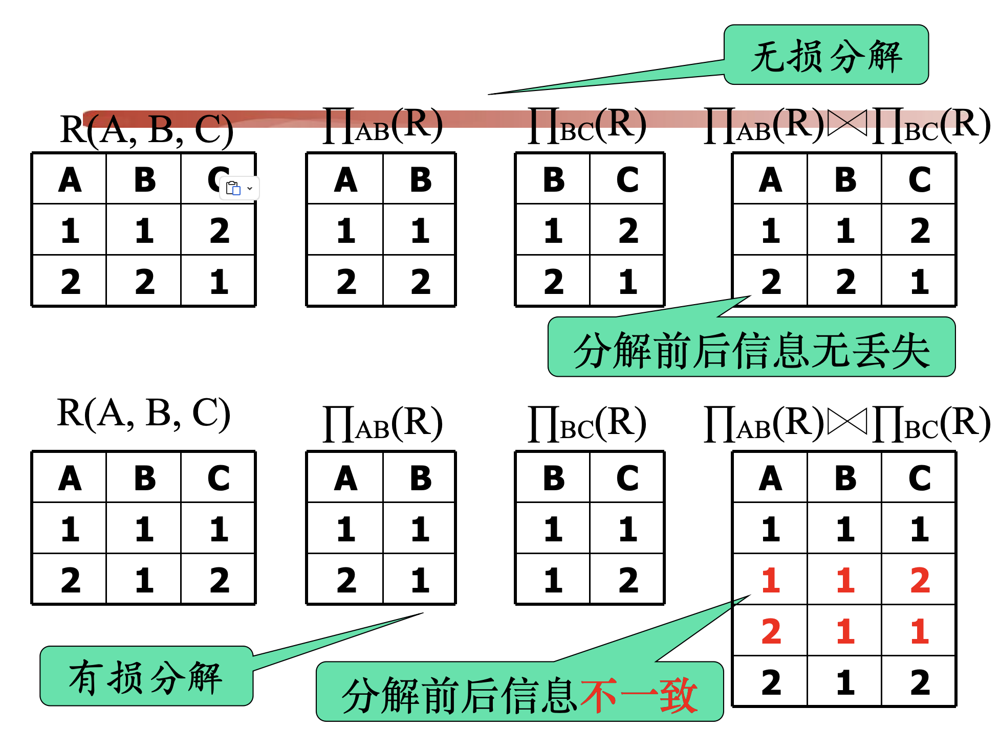

# 关系数据库设计

## 问题的提出

### 关系模式

关系模式：对于关系的描述，表示为 `R(U, D, Dom, F)`。

- `R`：关系名
- `U`：属性名的集合
- `D`：各个属性的域
- `Dom`：各个属性和域的映射
- `F`：属性之间的依赖关系

由于 `D`, `Dom` 对关系模式设计影响不大，因为在这里简化为 `R(U, F)`：

- 当且仅当 `U` 上的一个关系 `r` 满足 `F` 时，**称 `r` 为关系模式 `R(U, F)` 上的一个关系**
- 关系中每一个分量必须是不可再分的数据项，满足这个条件的关系模式是**第一范式 (1NF)**

### 数据依赖

数据依赖：关系内部属性与属性之间的一种约束关系，其中最重要的是**函数依赖**和**多值依赖**。

````sql
create table student(
	id char(13),
  name varchar(40),
  college char(3),
  primary key (id)
);
````

对于以上的关系有这些函数依赖 $id \rightarrow name$, $id \rightarrow college$​。

### 冗余

有如下基本表：
````sql
create table student_choose_course(
  student_id char(13),
  student_name varchar(40),
  student_college_id char(3),
  student_college_name varchar(40),
  course_id char(8),
  course_name varchar(40),
  course_college_id char(3),
  course_college_name varchar(40),
  score int,
  credit int,
  primary key (student_id, course_id)
);
````

可以看出这个关系有冗余的问题，将多个实体和关系混在了一张基本表中。

解决方法：将大基本表分解为小基本表，做到函数依赖只有 $主码 \rightarrow 非主码$ 的形式，冗余就比较小。

## 规范化的定义

### 函数依赖

函数依赖的规范化定义：设 `R(U)` 是属性集 `U` 上的关系模式，`X`, `Y` 是 `U` 的子集。如果对于 `R` 中任何一个可能的关系 `r`，不可能存在两个元组在 `X` 属性上值相等但是在 `Y` 属性上值不相等，则称 `Y` 依赖于 `X`，记作 $X \rightarrow Y$。

> - 如果 $X \rightarrow Y$ 并且 $Y \rightarrow X$，则 $X \leftrightarrow Y$​
> - 如果 `Y` 不依赖于 `X`，则 $X \nrightarrow Y$

函数依赖还分为：

- 非平凡函数依赖：$X \rightarrow Y$ 并且 $Y \nsubseteq X$，则是非平凡函数依赖
- 平凡函数依赖：$X \rightarrow Y$ 但是 $Y \subseteq X$，则是平凡函数依赖

> ```sql
> create table student(
> 	id char(13) primary key,
>   name varchar(40) not null,
>   birth date not null,
>   college char(3) references college
> );
> ```
>
> - 如果 $X = \{id\}$​且 $Y = \{name\}$​， 则是非平凡函数依赖
> - 如果 $X = \{id, name\}$且 $Y = \{name\}$， 则是平凡函数依赖

函数依赖还分为：

- 完全函数依赖：$X \rightarrow Y$ 并且对于 $X$ 的任意真子集 $X'$ 都有 $X' \nrightarrow Y$，则是完全函数依赖 $X \xrightarrow{\text{F}} Y$
- 部分函数依赖：$X \rightarrow Y$ 并且对于 $X$ 的部分真子集 $X'$ 存在 $X' \rightarrow Y$，则是部分函数依赖 $X \xrightarrow{\text{P}} Y$

> ```sql
> create table select_course(
> 	student char(13),
> 	course char(8),
> 	semester date,
> 	score int
> 	primary key (student, course, semester),
>   foreign key (student) references student,
>   foreign key (course) references course
> );
> ```
>
> - $X = \{student, course, semester\}$，$Y = \{score\}$ 则是完全函数依赖
> - $X = \{student, course, semester, score\}$，$Y = \{score\}$ 则是部分函数依赖

传递函数依赖：如果 $X \rightarrow Y$，$Y \rightarrow Z$，$Y \nsubseteq X$，$Y \rightarrow X$ 则称为传递函数依赖，记作 $X \xrightarrow{\text{transitive}} Z$。

## 范式

几个范式之间的联系是：
$$
4NF \subset BCNF \subset 3NF \subset 2NF \subset 1NF
$$
也就是说**高级别范式默认符合低级别范式的要求**。

某一关系模式属于第几范式记作：
$$
R \in nNF
$$
规范化：一个低级别范式通过**模式分解**转换为若干个高级别范式的过程。

### 1NF

定义：关系中每一个分量必须是不可再分的数据项。


### 2NF

定义：R中每一个非主属性完全依赖R中的码。

如下例子中的码是 `(student_id, course_id)`，非主属性是剩下的属性。

但是有 $(student\_id, course\_id) \xrightarrow{\text{P}} student\_name;student\_id \xrightarrow{\text{F}} student\_name$，所以不满足第二范式。

```sql
create table student_choose_course(
  student_id char(13),
  student_name varchar(40),
  student_college_id char(3),
  student_college_name varchar(40),
  course_id char(8),
  course_name varchar(40),
  course_college_id char(3),
  course_college_name varchar(40),
  score int,
  credit int,
  primary key (student_id, course_id)
);
```

### 3NF

定义：关系R中不存在 $X \rightarrow Y, Y \rightarrow Z$ 并且 $ Y \nrightarrow X$​，X是码，Z是非主属性。

如下的例子中：$id \rightarrow college \rightarrow dean$ 不满足3NF。

````sql
create table student(
	id char(13),
  name varchar(40),
  birth date,
  gender char(6),
  college char(3),
  dean char(10),
  primary key (id),
  check (gender in ('male', 'female'))
);
````

### BCNF

定义：如果 $X \rightarrow Y$ 则 X 中有码。

> 等价于每一个决定性因素中都包含码。

### 4NF

和多值依赖相关，not required

## 数据依赖的公理系统

### 蕴含

定义：根据已知的依赖能够推断出必然成立的依赖。

> 比如 $R(U, F)$ 中，$U = \{A, B, C\}$, $F = \{A \rightarrow B, B \rightarrow C\}$，
>
> 那么可以推断出 $A \rightarrow C$。

$F^+$：在关系模式 $R(U, F)$ 中由 $F$ 逻辑蕴含的所有函数依赖的集合，称为**函数依赖集**。

> $F^+$ 也包含了 $F$ 中的所有函数依赖，$F \subseteq F^+$。

最小函数依赖集满足下面三点要求，记作 $F_m$：

- $\rightarrow$ 右边只有一个属性
- 没有传递函数依赖
- 没有部分函数依赖

**每个函数依赖集都等价于最小函数依赖集**，最小函数依赖集没有改变依赖关系，只是减少了冗余度。

> 最小函数依赖集不是唯一的。

### 阿姆斯特朗公理系统

阿姆斯特朗公理系统规定了三种基本规则：

- 自反律：if $Y \subseteq X$, then $X \rightarrow Y$
- 增广律：if $X \rightarrow Y$, then $XZ \rightarrow YZ$
- 传递律：if $X \rightarrow Y, Y \rightarrow Z$, then $X \rightarrow Z$

阿姆斯特朗公理还有另外三个推论：

- 合并规则：if $X \rightarrow Y, X \rightarrow Z$, then $X \rightarrow YZ$
- 分解规则：if $ X \rightarrow YZ$, then $X \rightarrow Y, X \rightarrow Z$
- 伪传递规则：if $X \rightarrow Y, YZ \rightarrow P$, then $XZ \rightarrow P$

### 属性集闭包

$X_{F}^+$：给定关系模式 $R(U, F), X \subseteq U$，X能够函数决定的属性的集合，称为属性集X关于函数依赖集F的闭包。

> $X_{F}^+ = \{A | X \rightarrow A\}$。

属性闭包的作用：

- 测试X是否是超码，if true, then $X_F^+ = U$​ 
- 测试函数依赖是否成立，if $X \rightarrow Y$, then $Y \subseteq X_F^+$

#### 滚雪球算法

参考视频：[滚雪球算法讲解](https://www.bilibili.com/video/BV1W3411y7dw/?p=43&spm_id_from=888.80997.embed_other.whitelist&t=5.138403582664361&bvid=BV1W3411y7dw&vd_source=76f5735620c301501f88043fe989c6f4)。

### 正则覆盖

函数依赖集等价：如果 $F^+=G^+$，则函数依赖集 $F^+$覆盖 $G^+$ (或者 $G^+$ 覆盖 $$F^+$$)，也称为 $G^+$ 和 $F^+$ 等价。

> $G^+$ 和 $F^+$ 等价的充分必要条件：$F \subseteq G^+ \and G \subseteq F^+$

### 无关属性

无关属性：在函数依赖 $F$ 中，去掉某个属性后**整个函数依赖集所表达的约束没有改变**，这种属性称为无关属性。

> 有函数依赖集 $F=\{AB\rightarrow C,\;A\rightarrow D,\;D\rightarrow C\}$，
>
> $\because A\rightarrow D,\;D\rightarrow C$
>
> $\therefore A \rightarrow C$
>
> $\therefore AB \rightarrow C$ 中的B是无关属性。

## 模式分解

模式分解有两个要求：

- 无损连接性：分解后的多个小模式能够通过自然连接恢复为原来的模式
- 保持函数依赖：分解前后的函数依赖集等价


